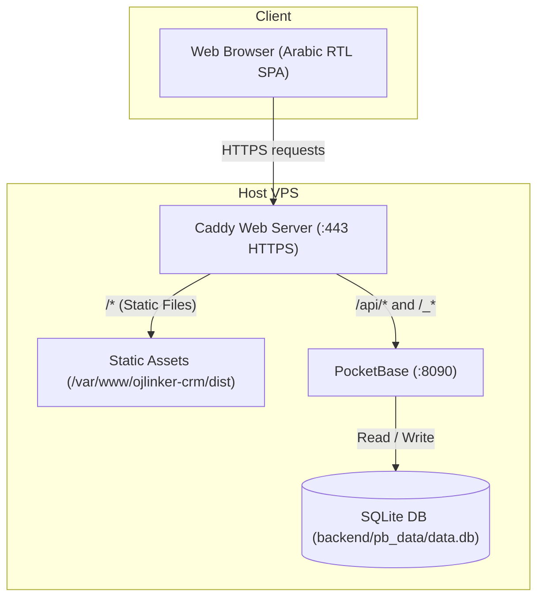

# OJLinker CRM — Engineering Handoff Document

**Date:** November 2026  
**System:** OJLinker CRM (Saudi Beauty Salon Cold-Contact & Sales Tracking System)  
**Target Architecture:** Linux VPS (Ubuntu/Debian) running Caddy + PocketBase  
**Git Branch:** `phase-1`

---

## 1. Executive Summary

The OJLinker CRM has been transitioned from an unbuilt mock prototype into a complete, production-grade, self-hosted web application:

1. **Vite SPA Migration:** Stripped out TanStack Start, Nitro, Cloudflare Workers, and Lovable Cloud proprietary dependencies. Rebuilt as a fast, clean Vite SPA with TanStack Router, TanStack Query, Tailwind 4, and shadcn/ui.
2. **Arabic-First & RTL Design:** Full Arabic user interface, `lang="ar"`, `dir="rtl"`, Western Arabic digits (0–9), `DD/MM/YYYY` date formatting, IBM Plex Sans Arabic typography, and timezone-aware calculations pinned to `Asia/Riyadh`.
3. **PocketBase Backend (v0.22.57):** Complete SQLite-backed schema with strict Arabic enum selects, automated sequential code increments (`SAL-XXXX` and `ACT-XXXXX`), atomic contact log creation with automatic client status derivation (`deriveClientUpdate`), and aggregated dashboard metrics (`GET /api/ojl/dashboard`).
4. **Complete Screen Suite:**
   - **لوحة المتابعة (Dashboard):** 8 KPI summary cards, sales funnel conversion bar chart, city donut chart, top 5 urgent follow-ups, and recent 8 activities. Genuine Arabic empty states when database has no records.
   - **متابعات اليوم (Today's Follow-ups):** Grouped sections (متأخرة, مستحقة اليوم, لاحقًا) with WhatsApp, phone, and log contact triggers.
   - **العملاء (Clients):** Dense tabular list, URL-synced search/sort/filters, mobile card view, full Add/Edit client dialog, and detailed slide-out Client Sheet.
   - **سجل التواصل (Contact Logs):** Complete contact timeline with channel/result/replied/date filters and pagination.
   - **الإعدادات (Settings):** Team member management (Admin/Agent) and UTF-8 BOM CSV exports for Excel compatibility.
5. **Zero Mock Policy:** Completely purged all mock stores, fake data, and mock switches. The frontend interacts strictly with PocketBase SDK through typed methods in `src/lib/api.ts`.
6. **Automated Testing & Screenshots:**
   - **31 Unit Tests:** Pure domain calculations, phone normalization, date/timezone math, and `deriveClientUpdate`.
   - **11 Integration Tests:** Real PocketBase instance tests covering authentication, authorization rules, code auto-increment, and cascading triggers.
   - **Playwright E2E Suite:** Automated end-to-end flow verifying authentication, client creation, contact logging, and dashboard KPI updates.
   - **20 UI Screenshots:** Captured at 1280px (desktop) and 390px (mobile) in both light and dark themes across all 5 primary views.

---

## 2. System Architecture



### Request Flow
1. **Frontend Assets:** Caddy serves pre-compressed static files (`.html`, `.js`, `.css`) from `/var/www/ojlinker-crm/dist` with `try_files {path} /index.html` for SPA client-side routing.
2. **API Requests:** Browser sends requests to `/api/*` and `/_*` (PocketBase Admin & SDK), which Caddy reverse-proxies directly to `127.0.0.1:8090`.
3. **Database & Business Logic:** PocketBase executes Goja JS hooks (`backend/pb_hooks/ojl.pb.js`) to enforce sequential codes, normalize Saudi phone numbers (`9665XXXXXXXX`), and update client statuses inside single SQLite transactions.

---

## 3. Verification & Development Commands

### Running Tests

```bash
# 1. Pure Unit Tests (fast)
npm run test

# 2. PocketBase Integration Tests (runs against throwaway PB on random port)
npm run test:integration

# 3. Playwright E2E Tests (spawns PB + Vite and tests live browser interactions)
npm run test:e2e

# 4. Strict TypeScript Typecheck
npx tsc --noEmit

# 5. Production Static Build
npm run build
```

### Local Development

```bash
# 1. Start local PocketBase instance
./backend/pocketbase serve --http=127.0.0.1:8090

# 2. Seed dev database (in separate terminal)
node backend/scripts/seed-dev.mjs --i-know-this-is-dev --url=http://127.0.0.1:8090

# 3. Start Vite dev server with proxy
npm run dev
# Accessible locally at http://localhost:5173
```

---

## 4. Default Credentials, Paths & Ports

| Item | Details |
|---|---|
| **PocketBase Admin** | `admin@ojlinker.sa` / `AdminPass12345!` (or configured via `create-admin.mjs`) |
| **Dev Agent User** | `agent@ojlinker.sa` / `AgentPass12345!` |
| **PocketBase Port** | `127.0.0.1:8090` |
| **Vite Dev Port** | `http://localhost:5173` (proxies `/api` and `/_` to `127.0.0.1:8090`) |
| **Caddy HTTPS** | `:443` (public) |
| **Application Root** | `/var/www/ojlinker-crm` |
| **Frontend Dist** | `/var/www/ojlinker-crm/dist` |
| **PocketBase Data** | `/var/www/ojlinker-crm/backend/pb_data` |
| **Backups Directory** | `/var/backups/ojlinker` |

---

## 5. UI Screenshots Showcase

All 20 screenshots are stored in `docs/screenshots/`:

| Page | Desktop (1280px) Light | Desktop (1280px) Dark | Mobile (390px) Light | Mobile (390px) Dark |
|---|---|---|---|---|
| **لوحة المتابعة (Dashboard)** | [`01-dashboard-1280-light.png`](screenshots/01-dashboard-1280-light.png) | [`01-dashboard-1280-dark.png`](screenshots/01-dashboard-1280-dark.png) | [`01-dashboard-390-light.png`](screenshots/01-dashboard-390-light.png) | [`01-dashboard-390-dark.png`](screenshots/01-dashboard-390-dark.png) |
| **متابعات اليوم (Today)** | [`02-today-1280-light.png`](screenshots/02-today-1280-light.png) | [`02-today-1280-dark.png`](screenshots/02-today-1280-dark.png) | [`02-today-390-light.png`](screenshots/02-today-390-light.png) | [`02-today-390-dark.png`](screenshots/02-today-390-dark.png) |
| **العملاء (Clients)** | [`03-clients-1280-light.png`](screenshots/03-clients-1280-light.png) | [`03-clients-1280-dark.png`](screenshots/03-clients-1280-dark.png) | [`03-clients-390-light.png`](screenshots/03-clients-390-light.png) | [`03-clients-390-dark.png`](screenshots/03-clients-390-dark.png) |
| **سجل التواصل (Log)** | [`04-log-1280-light.png`](screenshots/04-log-1280-light.png) | [`04-log-1280-dark.png`](screenshots/04-log-1280-dark.png) | [`04-log-390-light.png`](screenshots/04-log-390-light.png) | [`04-log-390-dark.png`](screenshots/04-log-390-dark.png) |
| **الإعدادات (Settings)** | [`05-settings-1280-light.png`](screenshots/05-settings-1280-light.png) | [`05-settings-1280-dark.png`](screenshots/05-settings-1280-dark.png) | [`05-settings-390-light.png`](screenshots/05-settings-390-light.png) | [`05-settings-390-dark.png`](screenshots/05-settings-390-dark.png) |

---

## 6. Known Limitations & Recommended Next Steps

1. **WhatsApp Web Direct Messaging:**
   - The UI generates standard `https://wa.me/9665XXXXXXXX?text=...` links which open in the user's browser or WhatsApp desktop. For full two-way automated WhatsApp conversation sync, integrate an official WhatsApp Business Cloud API webhook.
2. **Bulk Actions:**
   - The Clients table supports row-by-row actions. If the sales team expands past 1,000 clients, consider adding multi-select checkboxes for bulk assignment or bulk status changes.
3. **Role-Based Column Masking:**
   - Currently, agents can view all salon contact information. If desired, phone numbers could be partially obfuscated for restricted agent tiers.
4. **Push Notifications:**
   - Overdue follow-ups are displayed prominently on the dashboard and sidebar badge. PocketBase supports server-sent events (SSE) which could be used to push live notifications when a team member logs an activity.
